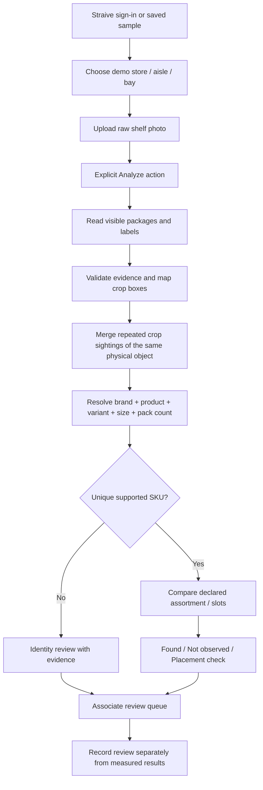

# Straive Shelf Check → Albertsons retail concept

Research date: 31 October 2026. Status: planning only. No application changes, paid inference, dataset-form submissions, commits or deployments performed.

## Recommendation

Build a **Straive Shelf Check: Grocery Shelf Audit** concept for an Albertsons discussion. Start with packaged shelf-stable grocery: cereal, canned goods, sauces and beverages. The first workflow should help an associate inspect a photographed bay, identify visible product variants, compare the bay with a declared assortment, and prioritize checks. This is a proposed workflow, not a deployed Albertsons system or an integration we already have.

Start with one category and a small, auditable catalogue. Cereal cartons are a useful first capture target because front panels can expose product names, variants and sizes. Canned goods and sauces provide harder near-duplicate cases. Actual category selection must follow image quality and exact catalogue overlap; do not fabricate product identities to fit an attractive image.

## Original source confirmed

Local source: `/Users/roshansingh/Desktop/bookshelf_demo/final version`.

Read its README, company-auth components, recognition prompt and comparison logic. It retains Straive Innovation credit, Foundry token/login handling, and the company inference endpoint. Preserve that integration when implementation is later requested. Do not base the conversion on `/Users/roshansingh/Desktop/Book2`, which is the personal-key project.

The inspected source uses:
- `app/src/foundryAuth.ts`: company session/login handling.
- `app/src/components/FoundryLoginGate.tsx`: company login UI.
- `server/recognition.py`: image crops, vision request, parsing, grouping and audit.
- `server/comparison.py` and `server/text.py`: book-specific identity matching.
- `app/src/analysisSummary.ts` and results components: unique expected-title summary.
- `pipeline/`: simulated catalogue and saved samples.

Source presence is verified; successful live gateway access has not been retested. Before implementation, record the source Git revision and working-tree state so local uncommitted work is preserved.

## Evidence-backed dataset shortlist

### 1. Humans in the Loop Supermarket Shelves — first candidate for public shelf imagery

Publisher reports 45 shelf images, 11,743 bounding boxes, two classes (Product and Price), CC0 1.0, and explicitly permits academic and commercial use. This is a practical small source for bounding-box overlays and product/price-label detection. It does not provide exact SKU, UPC, slot-planogram, OCR or stockout ground truth merely by having boxes. Those layers need additional annotation.

Access is through a publisher form. The archive was not downloaded and no form was submitted. Full-resolution suitability and individual files are not yet vetted. Public preview images are annotated screenshots, not raw benchmark inputs; using visible annotation overlays as inference inputs would contaminate evaluation.

Source: https://humansintheloop.org/resources/datasets/supermarket-shelves-dataset/

Preview links for visual reference only:
- https://humansintheloop.org/wp-content/uploads/2022/07/Screenshot-at-Jul-05-17-09-32-1-768x451.png
- https://humansintheloop.org/wp-content/uploads/2022/07/Screenshot-at-Jul-05-17-10-28-1-768x478.png

### 2. Open Food Facts — supporting product metadata and reference packshots

Useful candidate source for barcode-linked names, brands, quantities and product photos. Match records to products actually visible in chosen photos; coverage of Albertsons private-label variants has not been established. It is not a shelf-image dataset and does not establish a store's assortment or current price.

Publisher distinguishes ODbL database terms, Database Contents License for individual contents and CC BY-SA for product images. Preserve per-asset attribution and review the reuse conditions for the chosen distribution. Keep the external reference layer separate from any future private retailer catalogue; do not assume all data has a CC0 licence.

Source: https://openfoodfacts.github.io/documentation/docs/Product-Opener/api/tutorials/license-be-on-the-legal-side/

### 3. SKU-110K — dense-detection research benchmark, not the first client-demo asset source

Original project concerns densely packed shelf-object detection. It is useful for studying separation of touching/near-identical packages, but object detection is not exact SKU recognition. Original publisher restricts the dataset to academic and non-commercial purposes. A third-party mirror's more permissive label does not override that statement. Keep it out of client-demo assets unless the required rights are obtained.

Source: https://github.com/eg4000/SKU110K_CVPR19

### 4. RPC — secondary fine-grained recognition research

Original project provides individual-product exemplars and checkout scenes: 53,739 training images, 6,000 validation images and 24,000 test images. It is checkout-oriented rather than shelf/planogram-oriented. Publisher states CC BY-NC-SA 4.0 and requests contact for other uses. It is not an immediately suitable commercial-demo asset pool.

Source: https://rpc-dataset.github.io/

### 5. Grocery Store Dataset — secondary grocery classification reference

Original repository describes 5,125 smartphone images, 81 fine-grained classes and 42 broader classes, covering produce and carton items. Useful for classification experiments; not a complete US grocery SKU-level shelf benchmark. Repository has MIT licensing, but its README also says iconic images/descriptions were downloaded, so inspect asset provenance before external reuse. Do not infer rights to third-party images solely from the repository badge.

Source: https://github.com/marcusklasson/GroceryStoreDataset

### 6. Permissioned custom photographs — best route to a convincing Albertsons-specific pilot

Capture or obtain approved raw bay photos and matching product-master/assortment extracts. Include own-brand products only where those actual products appear in the images and matching records are available. These photographs provide the strongest link between scene, product identity and expected shelf assignment. No public dataset reviewed supplies that complete Albertsons-specific chain.

Albertsons' official brand page lists Signature Select, O Organics, Lucerne and Open Nature, among others. These are relevant category-planning examples, not evidence that a particular public photo or demo catalogue belongs to Albertsons.

Source: https://www.albertsons.com/about-us/our-brands.html

## Image acquisition and selection plan

Proposed first development package: 24 raw photographs across 3 physical bay setups, with 8 views per setup. Reserve whole scenes/capture sessions for held-out evaluation so overlapping crops, near-identical photos and repeat setups do not leak across development and test sets. This is a small feasibility set, not proof of chain-wide performance. Add different stores and packaging versions for broader evaluation.

Select six presentation cases from an independently annotated pool:
1. Clear frontal bay with readable brands and sizes: normal identity workflow.
2. Same brand with different flavour, size or pack count: exact-variant discrimination.
3. Multiple adjacent copies of one SKU: visible-facing instance preservation.
4. A clearly visible gap in a fully imaged expected slot: possible replenishment check.
5. A known product in the wrong declared bay or slot: placement review.
6. Glare, partial occlusion or an unreadable distinguishing size: explicit abstention.

Aim for original high-resolution files, level capture, full bay boundaries and enough label detail to read relevant attributes. Require one wider context view plus close-ups when shelf tags matter. Exclude screenshots, existing detection overlays and AI-generated imagery from accuracy evaluation. Synthetic scenes may demonstrate UI behavior only when labelled synthetic.

Each image needs: source URL or capture reference, permission/licence record, original filename, hash, dimensions, capture/store context if actually known, transformation history and split. Preserve raw files. Do not describe generic overseas supermarket photographs as Albertsons stores.

An independent human annotation pass must record product instances, visible brand/name/variant/size text, boxes, unreadable fields, shelf rows, label boxes, visible gaps and uncertain boundaries. Expected assortment/planogram comes from a separately declared source; observing what is present cannot establish what should have been present. Freeze the answer key before running the model. Never build evaluation truth from the model's predictions.

## Albertsons use cases and realistic boundaries

| Proposed use | Evidence needed | Demo action |
|---|---|---|
| Assortment verification | Image + product master + bay assortment | Found / Needs identity review / Not observed |
| Replenishment checks | Visible gap + expected slot; inventory snapshot if available | Ask associate to check shelf/backroom |
| Wrong variant or misplaced product | Resolved product identity + assignment | Show image evidence and expected assignment |
| Private-label execution | Actual own-brand products + approved assortment | Review presence and visible facings |
| Price-label review, later phase | Readable tag, correct product association, store/date/channel price and promotion rules | Flag possible mismatch for review |
| Prioritized e-commerce availability checks, later phase | Shelf evidence + actual order/pick context | Queue a verification task; do not promise availability |

Afresh's October 23, 2025 release reports rollout of fresh replenishment across Albertsons Companies fresh departments. This supports positioning our proposal as an additional visual shelf-evidence workflow rather than assuming the retailer has no inventory/ordering technology. Integration points remain discovery questions; we have no internal API access or approved system architecture.

Source: https://www.afresh.com/resources/press-release/afresh-completes-ai-powered-fresh-replenishment-and-inventory-management-solution-roll-out-across-all-albertsons-companies-fresh-departments

Avoid first-phase claims about expiry detection, spoilage, total inventory, automated ordering or confirmed stockouts. A front-of-shelf image cannot establish hidden depth/backroom stock, and expiry dates may not be visible.

## Proposed user journey



Frontend: retain the three-panel structure. Left: expected products with packshots and complete variant labels. Centre: image, zoom, selectable estimated outlines and raw text evidence. Right: actionable exceptions. Top: expected unique SKU summary. Avoid presenting catalogue match as independent visual verification.

For a synthetic 20-SKU example: 15 Found + 3 Needs identity review + 2 Not observed = 20 expected SKUs. Product instances and visible-facing estimates are separate counts; ten visible copies of one SKU contribute one unique found SKU. This arithmetic is an illustrative UI fixture, not measured performance.

Review actions: confirm identity, mark checked, request close-up and reject suggestion. A review does not silently alter raw evidence, benchmark results or inventory. If review persistence is added, save reviewer, time, previous state and decision separately; current browser-session acknowledgement is not a production workflow.

## Backend changes that matter

1. Replace book fields with retail evidence: brand, product name, variant, net quantity, pack count, packaging text, readable barcode, box and uncertainty reasons. Preserve raw strings; normalize structured attributes separately.
2. Preserve package instances. Existing title-based grouping can collapse repeated products. Merge overlapping crop sightings using full-image geometry and compatible evidence; never merge simply because the SKU name is identical. Unknown boxes must not inflate facing counts.
3. Separate entity keys: product ID (SKU/GTIN), observation ID (physical visible instance) and allocation ID (product expected at bay/slot). A SKU can have multiple instances and allocations.
4. Resolve with evidence. Prefer decoded/validated barcode when visible; otherwise require distinguishing brand, name, variant, size and pack attributes. Missing attributes produce ambiguity when multiple plausible variants remain. Visual similarity retrieves candidates; it does not override a visible conflict.
5. Normalize compatible units only; distinguish mass, volume, total pack size and per-item size. Sugar-free, regular, flavour, concentration and count differences are identity-critical. Do not copy the book 0.85 threshold into retail as if calibrated.
6. Keep recognition blind to the expected bay list. Catalogue matching follows extraction. A future candidate-assisted second pass should be separately labelled and evaluated, with an explicit none-of-the-above option.
7. Assortment coverage needs only product-to-bay expectations. Exact planogram compliance additionally needs row, slot, sequence/facing expectations, mapped image regions and sufficient scene coverage. Return unavailable when these inputs are absent.
8. Preserve company auth, transient token handling, TLS verification, explicit paid-run initiation, bounded recovery, cancellation, auditable raw responses and saved-result recomparison. Never log tokens. Benchmark crop sizes and cost on grocery scenes rather than assume the book defaults are optimal.

Proposed initial API shape can retain upload/scan/recompare separation. Add a versioned retail response contract and explicit `data_mode: simulated|permissioned_pilot`, `catalogue_version`, `planogram_version`, `capture_id`, `observation_id`, `matched_sku_id`, `identity_status`, `location_status`, `reason_codes` and provenance. Prices and inventory snapshots must include source/time/context or be null.

## Matching example

Illustrative fictional catalogue, not Albertsons product data:

```json
{
  "sku_id": "DEMO-CEREAL-001",
  "brand": "Demo Pantry",
  "product_name": "Oat Rings",
  "variant": "Original",
  "net_quantity": {"value": 12, "unit": "oz", "dimension": "mass"},
  "pack_count": 1,
  "gtin": null,
  "data_mode": "simulated"
}
```

An observation showing Demo Pantry / Oat Rings / Original / 12 oz can support this candidate if no conflicting exact variant remains. A 20 oz reading must reject this SKU. If size is unreadable and both 12 oz and 20 oz candidates exist, return identity review. Do not let selected-bay membership fabricate missing size evidence. Nearby price-label evidence must retain its separate source and uncertain association.

## Delivery sequence and evaluation

Phase 1: verify source snapshot; curate assets and rights; independently annotate; freeze catalogue and ground truth. Deliver source manifest and six candidate demo cases.

Phase 2: build retail schemas and saved replay UI; mock company auth/inference in automated checks. Retain original company app separately. No book benchmark scores in retail result cards.

Phase 3: implement extraction, instance fusion and variant resolution. Test same-name different-size, sugar-free/regular, multipack/single, repeated facings, cross-crop duplicates, unknown product and unreadable label cases.

Phase 4: run an explicitly authorized small live sample through the company gateway; record actual latency, tokens, request counts, failures and cost if known. Evaluate held-out scenes and revise thresholds only using development data.

Report detection precision/recall at declared IoU, exact-SKU precision/recall, variant errors, abstention rate, visible-facing error where countable, task precision, and per-image latency. SKU results need localization correspondence or a clearly stated image-level metric; do not mix the two. Missing/occluded/cropped-out items must not become false stockout truth. Separate replay UI checks, manually authored fixtures and real model inference.

Pilot discovery inputs: approved store photography, product master with UPC/GTIN/size/pack attributes and packshots, store assortment, actual planogram if slot compliance is required, dated price/promotion data if pricing is included, and any agreed task-system export interface. No claimed ROI until a timed baseline and pilot are measured.

## What remains unverified

No full dataset archive inspected, no final individual photo IDs selected, no Albertsons catalogue obtained, no exact OFF-to-shelf coverage demonstrated, no private-label recognition tested and no live corporate-gateway call made. The shortlist is source-researched; production feasibility and per-image suitability remain implementation/evaluation work.
